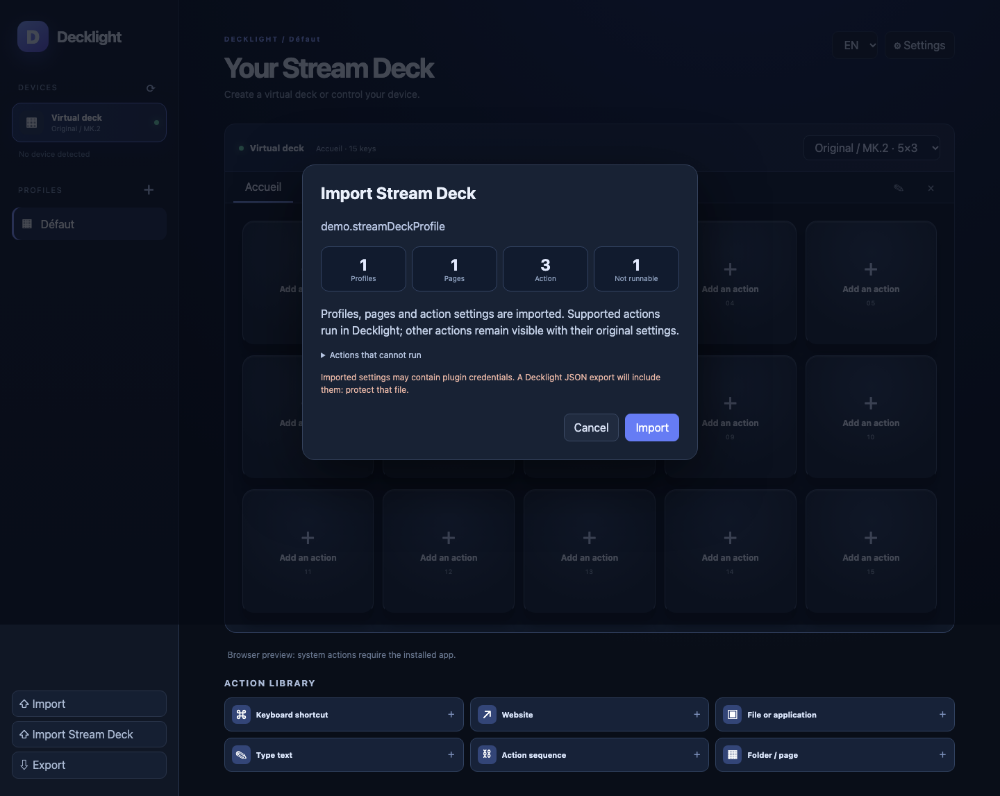

<p align="center"></p>

<h1 align="center">Decklight</h1>

<p align="center"><b>Ein schlankes virtuelles Stream Deck, das unterstützte USB-Modelle steuert und Stream-Deck-Profile importiert.</b></p>

<p align="center"> <a href="https://github.com/jeremdevgit/decklight/releases"></a> <a href="LICENSE"></a> <a href="https://github.com/jeremdevgit/decklight/actions/workflows/ci.yml"></a></p>

<p align="center"><a href="README.md">English</a> · <a href="README.fr.md">Français</a> · <a href="README.es.md">Español</a> · <b>Deutsch</b> · <a href="README.it.md">Italiano</a> · <a href="README.pt.md">Português</a> · <a href="README.zh.md">简体中文</a> · <a href="README.ja.md">日本語</a></p>

<p align="center"><a href="https://github.com/jeremdevgit/decklight/releases"><b>⬇ Herunterladen</b></a></p>


Decklight ist ein virtuelles Aktionspult für Windows, macOS und Linux. Es nutzt Tauri und die Web-Engine des Systems statt eines mitgelieferten Browsers und **kann echte Stream Decks per USB steuern**. Es ist eine Vorschau und noch kein vollständiger Ersatz für die offizielle Software.

## Auf einen Blick

| | |
|---|---|
| **Kategorie** | 🛠️ System & Hardware |
| **Plattformen** | Windows · macOS · Linux |
| **Oberfläche** | 8 Sprachen (EN, FR, ES, DE, IT, PT, ZH, JA) |
| **Preis** | Kostenlos, quelloffen, ohne Werbung und Telemetrie |
| **Status** | Vorschau |
| **Lizenz** | [GPL-3.0-or-later](LICENSE) |

## Was es kann

- **Virtuelle Layouts** für Mini, Original/MK.2, XL, Neo, Plus, Plus XL, Pedal, Studio und Mobile sowie eigene Raster.
- **USB-Steuerung** der vom Treiber `elgato-streamdeck` unterstützten Modelle: Tastenbilder, Tastendrücke und getrennte Aktionen für Drücken und Drehen der Regler von Plus/Plus XL.
- **Aktionen**: Websites und Dateien öffnen, Tastenkürzel, Text eingeben, Medientasten, Pausen und Abfolgen.
- Mehrere **Profile, Seiten und Ordner**; Name, Symbol und Farbe pro Taste; JSON-Import/-Export.
- **Stream-Deck-Import**: `.streamDeckProfile`- und `.StreamDeckProfilesBackup`-Dateien mit Seiten, Aktionen, Bildern und Originaleinstellungen, mit einem Bericht zur Prüfung vor dem Hinzufügen.



## Unterstützte Hardware

Die USB-Steuerung deckt Original, Mini, MK.2, XL, Neo, Plus, Plus XL und Pedal ab (mit ihren aufgeführten Revisionen). Studio, Mobile und G-Tasten werden nicht unterstützt; Touchleisten des Plus, die Infoleiste des Neo, Elgato-Plugins und automatische App-Profile sind nicht umgesetzt. Importierte Plugin-Aktionen bleiben als inaktive Tasten sichtbar. Decklight muss geöffnet bleiben, um ein Gerät zu steuern, und die offizielle Software muss es eventuell erst freigeben. Nicht jedes Modell wurde physisch getestet.

## Installation

Lade die Version für dein System von der [Release-Seite](https://github.com/jeremdevgit/decklight/releases). macOS-Builds sind nicht signiert; Windows- und Linux-Builds noch nicht.

- **macOS**: Tastaturaktionen benötigen die Berechtigung „Bedienungshilfen“.
- **Linux**: installiere `xdg-open`, einen X11/Wayland-Eingabedienst für Tastaturaktionen und die [udev-Regeln](https://github.com/OpenActionAPI/rust-elgato-streamdeck#udev-rules-for-linux) für Elgato-Geräte.

## Sicherheit und Datenschutz

- **Kein Konto, keine Cloud, keine Telemetrie, keine Shell-Ausführung, kein Hintergrundserver.**
- URLs nur mit HTTP, HTTPS und mailto; Dateiaktionen brauchen einen existierenden absoluten Pfad; Werte gehen nie an eine Shell.
- Importierte Dateien werden auf Größe und Struktur geprüft. Ein exportiertes JSON kann Plugin-Einstellungen aus Importen enthalten, eventuell Zugangsdaten: behandle es als vertraulich.

## Selbst bauen

```sh
# Rust, Node.js 22 und die Tauri-2-Voraussetzungen
npm ci
npm run desktop:dev
npm run desktop:build
```

## Lizenz

GPL-3.0-or-later – siehe [LICENSE](LICENSE). Der USB-Treiber ist [elgato-streamdeck](https://github.com/OpenActionAPI/rust-elgato-streamdeck) (MPL-2.0). Decklight ist nicht mit Elgato oder Corsair verbunden; Stream Deck ist eine Marke ihres Inhabers.

---

Eine Sicherheitslücke gefunden? Bitte privat melden (siehe [SECURITY.md](SECURITY.md)), nicht in einem öffentlichen Issue.

## Weitere freie Software von jeremdevgit

Alle kostenlos, quelloffen und werbefrei.

**🛠️ System & Hardware** — [Boîte à outils](https://github.com/jeremdevgit/boite-a-outils) · [rJb](https://github.com/jeremdevgit/rjb) · [LJ Hub](https://github.com/jeremdevgit/lj-hub)

**📒 Produktivität & Daten** — [Carnet de notes](https://github.com/jeremdevgit/carnet-rust) · [JMeca](https://github.com/jeremdevgit/jmeca) · [Suite Libre](https://jeremdevgit.github.io/suite-libre/)

**🎮 Musik & Spiele** — [Pomme](https://github.com/jeremdevgit/pomme) · [Ludothèque](https://github.com/jeremdevgit/ludotheque) · [AutoDex](https://github.com/jeremdevgit/autodex) · [Batailles de France](https://github.com/jeremdevgit/batailles-de-france)
