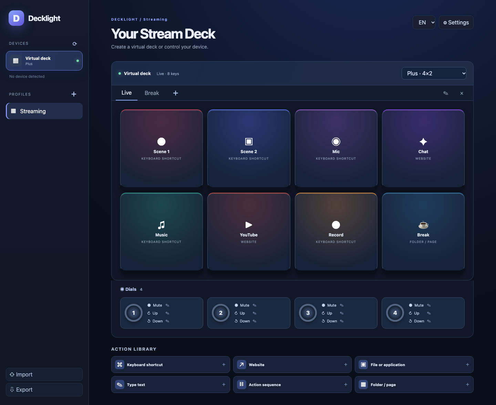

# Decklight

Decklight es un panel virtual ligero de acciones para Windows, macOS y Linux. La interfaz está disponible en francés, inglés, español, alemán, italiano, portugués, chino y japonés. Utiliza Tauri y el motor web del sistema.

La versión 0.1 ofrece paneles virtuales Mini, Original/MK.2, XL, Neo, Plus, Plus XL y Pedal, además de un formato personalizado. Detecta los dispositivos USB reconocidos por el controlador Rust, actualiza sus pantallas y responde a las pulsaciones. Las pulsaciones y giros de los diales Plus admiten acciones distintas. También incluye perfiles, páginas, carpetas, atajos, teclas multimedia, apertura de sitios y archivos, texto, pausas y secuencias. Los perfiles se guardan localmente y se importan o exportan como JSON.

**Límite actual:** no admite los modelos Studio, Mobile ni G-keys, las pantallas táctiles Plus y Neo, los plugins o perfiles Elgato ni el cambio automático de perfil. No se ha probado el USB con cada modelo real. La aplicación debe permanecer en ejecución y el software oficial puede tener que liberar el dispositivo. En macOS los atajos pueden requerir permiso de Accesibilidad; en Linux la entrada depende del servicio disponible y el USB puede requerir una [regla udev](https://github.com/OpenActionAPI/rust-elgato-streamdeck#udev-rules-for-linux).

Para compilar, instala Rust, Node.js 22 y los [requisitos de Tauri 2](https://v2.tauri.app/start/prerequisites/), y ejecuta `npm ci` y `npm run desktop:build`. Exporta tus perfiles en JSON para hacer copias de seguridad y revisa las acciones de los perfiles importados.

Decklight es independiente de Elgato y Corsair. Licencia GPL-3.0-or-later; autor: jeremdevgit.
