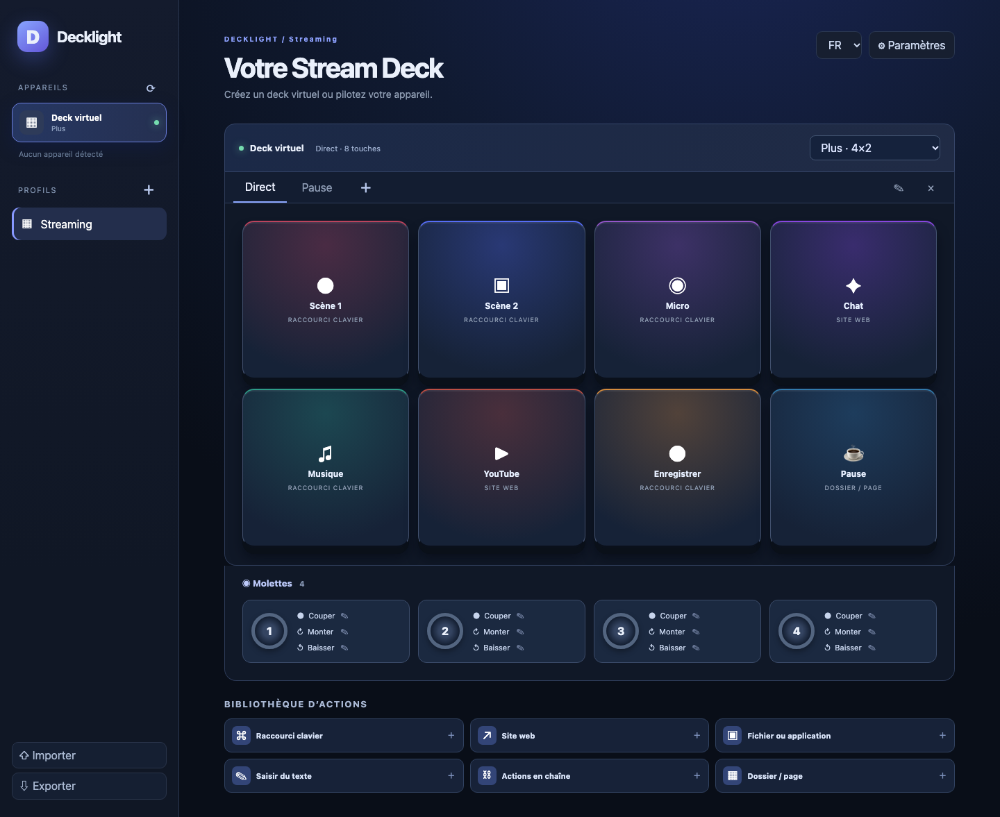

<p align="center"></p>

<h1 align="center">Decklight</h1>

<p align="center"><b>Un Stream Deck virtuel et léger qui pilote les modèles USB pris en charge et importe les profils Stream Deck.</b></p>

<p align="center"> <a href="https://github.com/jeremdevgit/decklight/releases"></a> <a href="LICENSE"></a> <a href="https://github.com/jeremdevgit/decklight/actions/workflows/ci.yml"></a></p>

<p align="center"><a href="README.md">English</a> · <b>Français</b> · <a href="README.es.md">Español</a> · <a href="README.de.md">Deutsch</a> · <a href="README.it.md">Italiano</a> · <a href="README.pt.md">Português</a> · <a href="README.zh.md">简体中文</a> · <a href="README.ja.md">日本語</a></p>

<p align="center"><a href="https://github.com/jeremdevgit/decklight/releases"><b>⬇ Télécharger</b></a></p>



Decklight est un pupitre d'actions virtuel pour Windows, macOS et Linux. Il utilise Tauri et le moteur web du système au lieu d'embarquer un navigateur, et **peut piloter de vrais Stream Deck en USB**. C'est une préversion, pas encore un remplaçant complet du logiciel officiel.

## En bref

| | |
|---|---|
| **Catégorie** | 🛠️ Système et matériel |
| **Plateformes** | Windows · macOS · Linux |
| **Interface** | 8 langues (EN, FR, ES, DE, IT, PT, ZH, JA) |
| **Prix** | Gratuit, open source, sans publicité ni télémétrie |
| **État** | Préversion |
| **Licence** | [GPL-3.0-or-later](LICENSE) |

## Ce qu'il fait

- **Dispositions virtuelles** Mini, Original/MK.2, XL, Neo, Plus, Plus XL, Pedal, Studio et Mobile, plus des grilles personnalisées.
- **Contrôle USB** des modèles pris en charge par le pilote `elgato-streamdeck` : images des touches, appuis, et actions distinctes pour l'appui et la rotation des molettes Plus/Plus XL.
- **Actions** : ouvrir des sites et des fichiers, raccourcis clavier, saisie de texte, touches multimédia, délais et séquences.
- Plusieurs **profils, pages et dossiers** ; nom, symbole et couleur par touche ; import/export JSON.
- **Import Stream Deck** : fichiers `.streamDeckProfile` et `.StreamDeckProfilesBackup` avec pages, actions, images et réglages d'origine, et un rapport à relire avant l'ajout.


## Matériel pris en charge

Le contrôle USB couvre Original, Mini, MK.2, XL, Neo, Plus, Plus XL et Pedal (avec leurs révisions listées). Studio, Mobile et les touches G ne sont pas pris en charge ; les bandeaux tactiles du Plus, la barre d'infos du Neo, les plugins Elgato et les profils automatiques par application ne sont pas implémentés. Les actions de plugins importées restent visibles comme touches inactives. Decklight doit rester ouvert pour piloter un appareil, et le logiciel officiel doit parfois le libérer d'abord. Tous les modèles n'ont pas été testés physiquement.

## Installer

Téléchargez la version pour votre système sur la [page des versions](https://github.com/jeremdevgit/decklight/releases). Les builds macOS ne sont pas signés ; ceux de Windows et Linux pas encore.

- **macOS** : les actions clavier demandent l'autorisation Accessibilité.
- **Linux** : installez `xdg-open`, un service de saisie X11/Wayland pour les actions clavier, et les [règles udev](https://github.com/OpenActionAPI/rust-elgato-streamdeck#udev-rules-for-linux) des appareils Elgato.

## Sécurité et confidentialité

- **Ni compte, ni cloud, ni télémétrie, ni exécution de shell, ni serveur en arrière-plan.**
- Adresses limitées à HTTP, HTTPS et mailto ; les actions fichier exigent un chemin absolu existant ; les valeurs ne passent jamais par un shell.
- Les fichiers importés sont contrôlés (taille, structure). Un JSON exporté peut contenir des réglages de plugins issus d'un import, parfois des identifiants : traitez-le comme une donnée sensible.

## Compiler

```sh
# Rust, Node.js 22 et les prérequis Tauri 2
npm ci
npm run desktop:dev
npm run desktop:build
```

## Licence

GPL-3.0-or-later — voir [LICENSE](LICENSE). Le pilote USB est [elgato-streamdeck](https://github.com/OpenActionAPI/rust-elgato-streamdeck) (MPL-2.0). Decklight n'est affilié ni à Elgato ni à Corsair ; Stream Deck est une marque de son propriétaire.

---

Une faille de sécurité ? Signalez-la en privé (voir [SECURITY.md](SECURITY.md)) plutôt que dans un ticket public.

## Mes autres logiciels libres

Tous gratuits, open source et sans publicité.

**🛠️ Système et matériel** — [Boîte à outils](https://github.com/jeremdevgit/boite-a-outils) · [rJb](https://github.com/jeremdevgit/rjb) · [LJ Hub](https://github.com/jeremdevgit/lj-hub)

**📒 Productivité et données** — [Carnet de notes](https://github.com/jeremdevgit/carnet-rust) · [JMeca](https://github.com/jeremdevgit/jmeca) · [Suite Libre](https://jeremdevgit.github.io/suite-libre/)

**🎮 Musique et jeux** — [Pomme](https://github.com/jeremdevgit/pomme) · [Ludothèque](https://github.com/jeremdevgit/ludotheque) · [AutoDex](https://github.com/jeremdevgit/autodex) · [Batailles de France](https://github.com/jeremdevgit/batailles-de-france)
