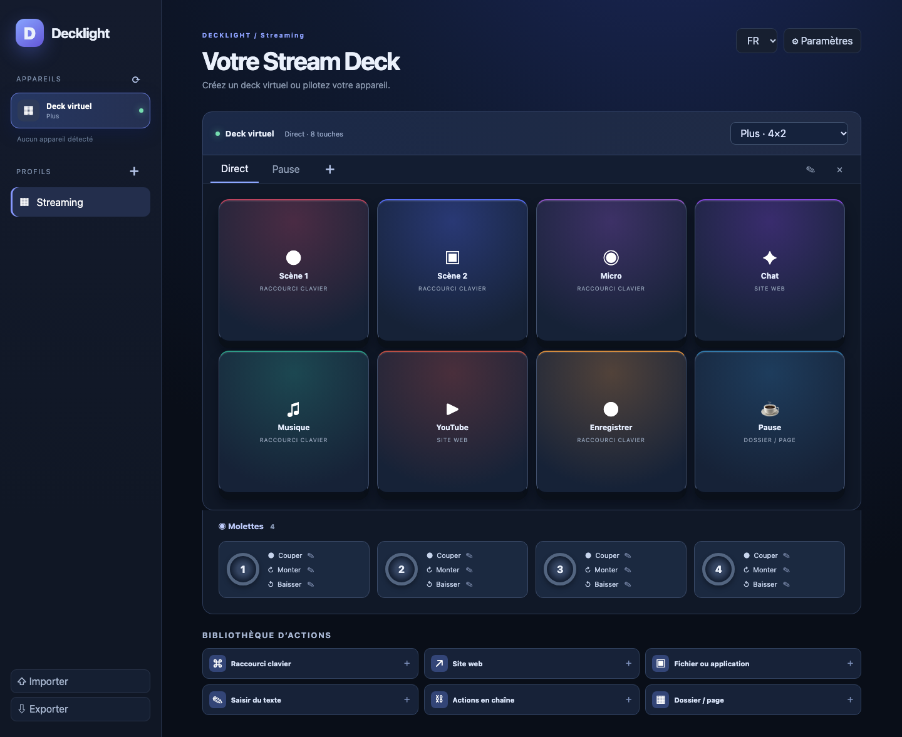

# Decklight

 

[English](README.md) · **Français** · [Español](README.es.md)

Decklight est une grille virtuelle de commandes légère pour Windows, macOS et Linux. L’interface est traduite en français, anglais, espagnol, allemand, italien, portugais, chinois et japonais. Elle utilise Tauri et le moteur web du système.

La version 0.2 propose un deck virtuel aux formats Mini, Original/MK.2, XL, Neo, Plus, Plus XL, Pedal, Studio et Mobile, ou personnalisé. Elle détecte les appareils USB reconnus par le pilote Rust, affiche les touches sur leur écran et réagit aux appuis. Les appuis et rotations des molettes Plus peuvent recevoir des actions distinctes. Profils, pages, dossiers, raccourcis clavier, touches multimédias, ouverture de sites et de fichiers, saisie de texte, pauses et enchaînements sont disponibles. Les profils restent sur l’ordinateur et s’importent ou s’exportent en JSON.

**Import Stream Deck :** Decklight lit les exports `.streamDeckProfile` et les sauvegardes `.StreamDeckProfilesBackup` contenant des profils, avec leurs pages, actions, images et réglages d’origine. Un bilan précède l’import. Les actions compatibles fonctionnent ; celles des plugins et les actions inconnues restent visibles mais inactives. Les préférences globales de l’application officielle et les plugins eux-mêmes ne font pas partie de cet import. Les grandes images peuvent être écartées pour limiter le stockage. Un export JSON Decklight contient les réglages conservés, parfois des identifiants de plugin : protégez ce fichier.

**Limite actuelle :** les modèles Studio, Mobile et G-keys, les bandes tactiles Plus et Neo, l’exécution des plugins Elgato ainsi que le changement automatique de profil ne sont pas pris en charge. La prise en charge USB n’a pas été testée sur chaque appareil réel. L’application doit rester lancée ; le logiciel officiel Stream Deck peut devoir libérer l’appareil. Sur macOS, les raccourcis peuvent demander l’autorisation Accessibilité ; sur Linux, l’injection clavier dépend du service d’entrée disponible et l’accès USB peut demander une [règle udev](https://github.com/OpenActionAPI/rust-elgato-streamdeck#udev-rules-for-linux).

Téléchargez la [préversion v0.2.0](https://github.com/jeremdevgit/decklight/releases/tag/v0.2.0) pour votre système. Pour compiler : installer Rust, Node.js 22 et les [prérequis Tauri 2](https://v2.tauri.app/start/prerequisites/), puis lancer `npm ci`, `npm run desktop:dev` ou `npm run desktop:build`. Les profils sont conservés dans le stockage local de l’application : exportez un fichier JSON pour les sauvegarder. Examinez les actions d’un profil importé avant de l’utiliser.

Decklight est indépendant d’Elgato et Corsair. Licence GPL-3.0-or-later ; auteur : jeremdevgit.

## Mes autres logiciels

Tous libres, gratuits et sans publicité — [github.com/jeremdevgit](https://github.com/jeremdevgit) :

| Logiciel | Plateforme | En bref |
|---|---|---|
| [AutoDex](https://github.com/jeremdevgit/autodex) | Windows, macOS, Linux | Jeu de collection de voitures avec reconnaissance de photos sur l'appareil |
| [Boîte à outils](https://github.com/jeremdevgit/boite-a-outils) | Windows, macOS | Entretien de l'ordinateur, nettoyage et recherche de fichiers |
| [Carnet de notes](https://github.com/jeremdevgit/carnet-rust) | Windows | Carnets chiffrés et synchronisation expérimentale |
| [JMeca](https://github.com/jeremdevgit/jmeca) | Windows, macOS, Linux | Suivi d'entretien de véhicules chiffré |
| [LJ Hub](https://github.com/jeremdevgit/lj-hub) | Windows, macOS, Linux | Gestionnaire de profils pour appareils Logitech |
| [Pomme](https://github.com/jeremdevgit/pomme) | Windows | Lecteur de musique Apple Music et fichiers locaux |
| [rJb](https://github.com/jeremdevgit/rjb) | Windows | Contrôle de l'éclairage RGB |
| [Ludothèque](https://github.com/jeremdevgit/ludotheque) | macOS | Bibliothèque et lanceur de jeux |
| [Suite Libre](https://jeremdevgit.github.io/suite-libre/) | Navigateur | Six outils sans compte |
| [Batailles de France](https://github.com/jeremdevgit/batailles-de-france) | Navigateur | Jeu de stratégie en temps réel |
