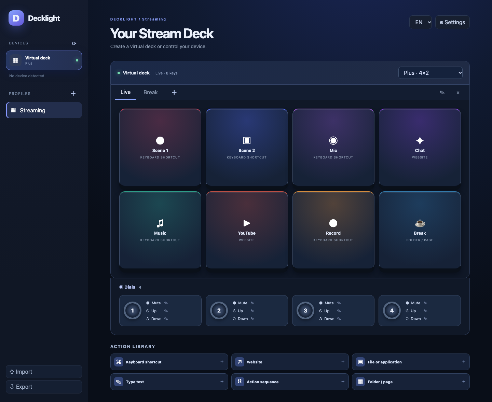

<p align="center"></p>

<h1 align="center">Decklight</h1>

<p align="center"><b>対応 USB モデルを操作し、Stream Deck プロファイルを読み込める軽量な仮想 Stream Deck。</b></p>

<p align="center"> <a href="https://github.com/jeremdevgit/decklight/releases"></a> <a href="LICENSE"></a> <a href="https://github.com/jeremdevgit/decklight/actions/workflows/ci.yml"></a></p>

<p align="center"><a href="README.md">English</a> · <a href="README.fr.md">Français</a> · <a href="README.es.md">Español</a> · <a href="README.de.md">Deutsch</a> · <a href="README.it.md">Italiano</a> · <a href="README.pt.md">Português</a> · <a href="README.zh.md">简体中文</a> · <b>日本語</b></p>

<p align="center"><a href="https://github.com/jeremdevgit/decklight/releases"><b>⬇ ダウンロード</b></a></p>



Decklight は Windows・macOS・Linux 向けの仮想アクションデッキです。ブラウザーを同梱せず Tauri と OS の Web エンジンを使い、**実物の Stream Deck を USB で操作できます**。プレビュー版のため、公式ソフトの完全な代わりにはまだなりません。

## 概要

| | |
|---|---|
| **カテゴリー** | 🛠️ システムとハードウェア |
| **対応環境** | Windows · macOS · Linux |
| **表示言語** | 8 言語（英・仏・西・独・伊・葡・中・日） |
| **価格** | 無料・オープンソース・広告なし・テレメトリーなし |
| **ステータス** | プレビュー版 |
| **ライセンス** | [GPL-3.0-or-later](LICENSE) |

## できること

- **仮想レイアウト**：Mini、Original/MK.2、XL、Neo、Plus、Plus XL、Pedal、Studio、Mobile、およびカスタムグリッド。
- `elgato-streamdeck` ドライバー対応モデルの **USB 制御**：キー画像、キー押下、Plus/Plus XL のダイヤルは押し込みと回転に別々のアクションを設定可能。
- **アクション**：Web サイトやファイルを開く、キーボードショートカット、文字入力、メディアキー、待機、連続実行。
- 複数の**プロファイル・ページ・フォルダー**、キーごとの名前・記号・色、JSON のインポート／エクスポート。
- **Stream Deck の読み込み**：`.streamDeckProfile` と `.StreamDeckProfilesBackup` のページ、アクション、画像、元の設定を取り込み、追加前に確認できるレポートを表示。


## 対応ハードウェア

USB 制御の対象は Original、Mini、MK.2、XL、Neo、Plus、Plus XL、Pedal（記載のリビジョンを含む）です。Studio、Mobile、G キーは非対応。Plus のタッチストリップ、Neo の情報バー、Elgato プラグイン、アプリごとの自動プロファイルは未実装です。読み込んだプラグインのアクションは無効なキーとして表示されます。デバイスを操作するには Decklight を起動したままにする必要があり、先に公式ソフトがデバイスを解放する必要がある場合もあります。すべてのモデルを実機で試したわけではありません。

## インストール

[リリースページ](https://github.com/jeremdevgit/decklight/releases)から OS に合ったビルドをダウンロードします。macOS 版は未署名、Windows 版と Linux 版もまだコード署名されていません。

- **macOS**：キーボードアクションには「アクセシビリティ」の許可が必要です。
- **Linux**：`xdg-open`、キーボードアクション用の X11/Wayland 入力サービス、Elgato デバイス用の [udev ルール](https://github.com/OpenActionAPI/rust-elgato-streamdeck#udev-rules-for-linux)をインストールしてください。

## 安全性とプライバシー

- **アカウント、クラウド、テレメトリー、シェル実行、常駐サーバーはありません。**
- URL は HTTP・HTTPS・mailto のみ。ファイルアクションには存在する絶対パスが必要で、値がシェルに渡されることはありません。
- 読み込むファイルはサイズと構造を確認します。書き出した JSON には読み込んだプラグイン設定（認証情報を含むことも）が入る場合があるため、機密データとして扱ってください。

## ソースからビルド

```sh
# Rust、Node.js 22、Tauri 2 の前提条件
npm ci
npm run desktop:dev
npm run desktop:build
```

## ライセンス

GPL-3.0-or-later — [LICENSE](LICENSE) を参照。USB ドライバーは [elgato-streamdeck](https://github.com/OpenActionAPI/rust-elgato-streamdeck)（MPL-2.0）です。Decklight は Elgato・Corsair と提携していません。Stream Deck は各所有者の商標です。

---

脆弱性を見つけたら、公開 Issue ではなく非公開で報告してください（[SECURITY.md](SECURITY.md) を参照）。

## jeremdevgit のその他のフリーソフトウェア

すべて無料・オープンソース・広告なし。

**🛠️ システムとハードウェア** — [Boîte à outils](https://github.com/jeremdevgit/boite-a-outils) · [rJb](https://github.com/jeremdevgit/rjb) · [LJ Hub](https://github.com/jeremdevgit/lj-hub)

**📒 生産性とデータ** — [Carnet de notes](https://github.com/jeremdevgit/carnet-rust) · [JMeca](https://github.com/jeremdevgit/jmeca) · [Suite Libre](https://jeremdevgit.github.io/suite-libre/)

**🎮 音楽とゲーム** — [Pomme](https://github.com/jeremdevgit/pomme) · [Ludothèque](https://github.com/jeremdevgit/ludotheque) · [AutoDex](https://github.com/jeremdevgit/autodex) · [Batailles de France](https://github.com/jeremdevgit/batailles-de-france)
