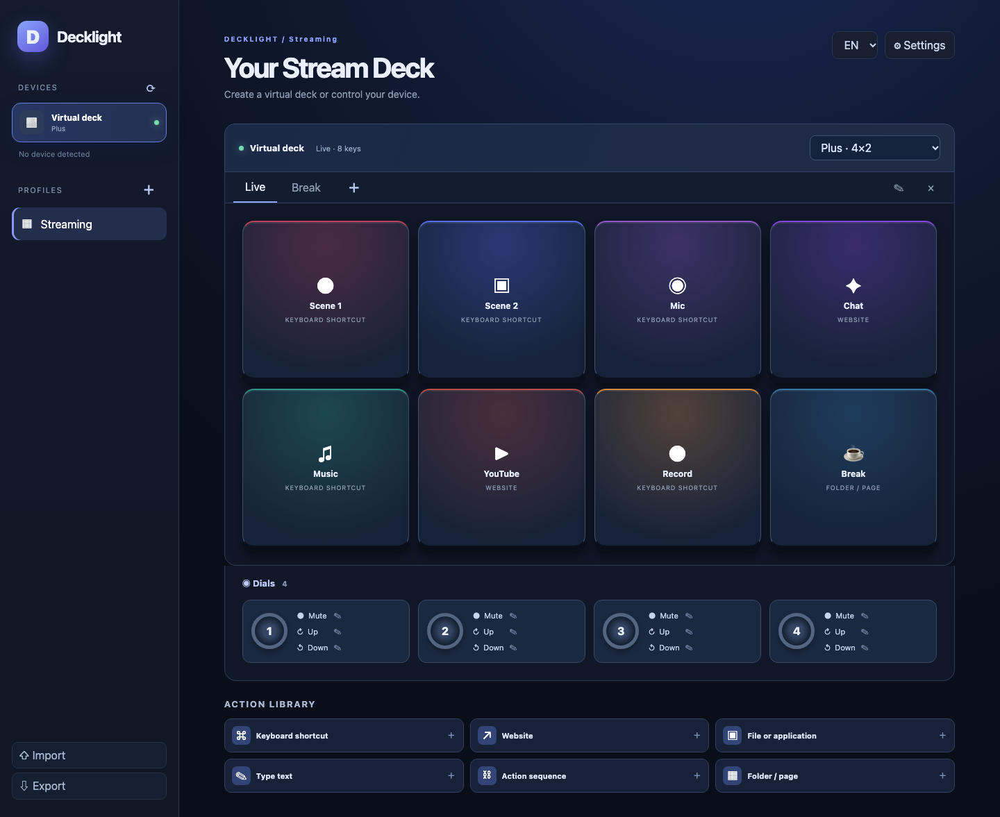

# Decklight

Decklight is a lightweight virtual action deck for Windows, macOS and Linux. It uses Tauri and the system webview instead of bundling a browser. The interface is available in French, English, Spanish, German, Italian, Portuguese, Chinese and Japanese.



## Features in 0.1

- Virtual layouts for Mini, Original/MK.2, XL, Neo, Plus, Plus XL, Pedal, Studio and Mobile, plus custom grids.
- USB device detection, key image updates and key presses for models supported by the `elgato-streamdeck` Rust driver. Plus and Plus XL encoder presses and turns can each have separate actions.
- Multiple profiles, pages and folder shortcuts.
- Website and file opening, keyboard shortcuts, text typing, media keys, delays and sequential actions.
- Per-key names, symbols and colors. Local profile storage with JSON import and export.
- No account, cloud service, telemetry, shell execution or background server.

Decklight 0.1 is **not yet a full Stream Deck replacement**. The driver covers Original, Mini, MK.2, XL, Neo, Plus, Plus XL, Pedal and their listed revisions/modules. Studio, Mobile, G-keys and other controllers are not supported. Plus touch strips, Neo's info strip, Elgato profile/plugin imports, automatic foreground app profiles and a plugin marketplace are not implemented. The app must stay running to control a USB device. Physical USB behavior has not been tested with every model. The official Stream Deck software may need to release the device before Decklight can connect.

Keyboard actions may need macOS Accessibility permission or a supported X11/Wayland input service on Linux. On Linux, install `xdg-open` for links and files, and add appropriate udev permissions for Elgato USB devices; see the [driver's udev guide](https://github.com/OpenActionAPI/rust-elgato-streamdeck#udev-rules-for-linux).

## Install and build

Download the build for your system from GitHub Actions artifacts. macOS builds are unsigned; Windows and Linux builds are not yet code signed. To build locally, install Rust, Node.js 22 and the [Tauri 2 prerequisites](https://v2.tauri.app/start/prerequisites/), then run:

```sh
npm ci
npm run desktop:dev
npm run desktop:build
```

Profiles live in the webview's local application storage. Export them regularly as JSON. Imported files are checked for size and structure; review their actions before running them. URLs are limited to HTTP, HTTPS and mailto. File actions require an existing absolute path. Decklight never passes action values to a command shell.

## Project

- [Français](README.fr.md)
- [Español](README.es.md)
- [Security policy](SECURITY.md)
- License: GPL-3.0-or-later
- Author: jeremdevgit

Decklight is an independent project and is not affiliated with Elgato or Corsair. Stream Deck is a trademark of its owner. The USB driver is [elgato-streamdeck](https://github.com/OpenActionAPI/rust-elgato-streamdeck), licensed MPL-2.0.
